<div align="center">


# HireMe AI · Ansh Singh's Portfolio

**An interactive, game-themed portfolio with a resume-grounded AI twin that recruiters can interview.**

*Model vs Product: every model needs a product. This site is both.*

[](https://anshsingh-ai.vercel.app)
[](https://anshsingh-ai.vercel.app/contact/)


**[🔗 Live demo](https://anshsingh-ai.vercel.app)** · **[✉️ Contact page](https://anshsingh-ai.vercel.app/contact/)** · **[💼 LinkedIn](https://www.linkedin.com/in/anshz)** · **[📄 Resume](https://anshsingh-ai.vercel.app/Ansh_Singh_Resume.pdf)**

<br />

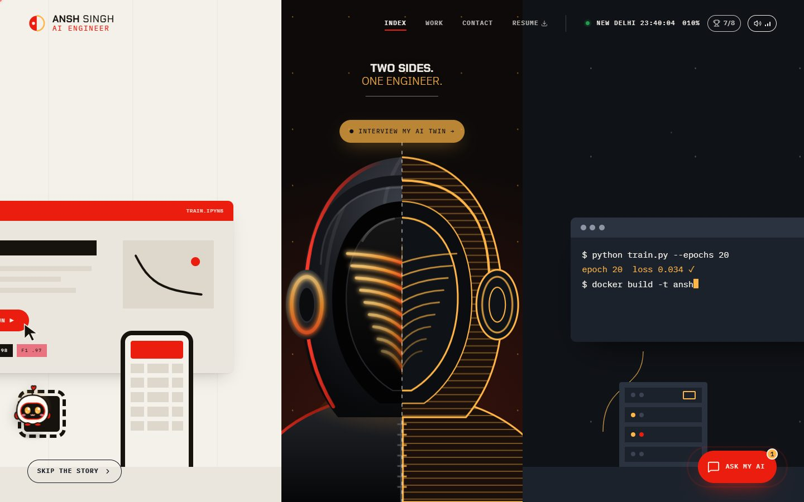

</div>

---

## Table of contents

- [About](#about)
- [Features](#features)
- [Screenshots](#screenshots)
- [How it works](#how-it-works)
- [Tech stack](#tech-stack)
- [Project structure](#project-structure)
- [Run it locally](#run-it-locally)
- [Environment variables](#environment-variables)
- [Deploying to Vercel](#deploying-to-vercel)
- [Security](#security)
- [Author](#author)

---

## About

Most portfolios are a list of links. This one is a small game you scroll through, built around one idea: **a model is only half the job, the other half is shipping it.**

- **Scroll the story.** The page splits into a *Model* half and a *Product* half, a mascot rises from the middle, and each chapter (the street, the factory, the player card, missions) shows real work.
- **Interview the AI twin.** A streaming chat assistant answers recruiters' questions using only my resume and public GitHub data, and says when it doesn't know something instead of inventing it.
- **Get in touch directly.** A contact page lets anyone pick a "mission" and send a message that lands in my inbox.

Everything runs on one Vercel project: a static React site on the global CDN and a FastAPI backend as serverless functions, on the same domain.

---

## Features

| | Feature | Details |
|---|---|---|
| 🎬 | **Scroll-scrubbed story** | "Model vs Product" split hero: halves slide apart, the mascot rises, the name types itself, then everything closes again |
| 🏪 | **The street** | Projects as shop fronts on a sideways-scrolling street; doors swing open to live demos and code |
| 🏭 | **The factory** | Live GitHub repos arrive as crates on a conveyor belt and get stamped "Shipped" |
| 🃏 | **Player One card** | Flippable stats / quest-log card with dot-matrix readouts, plus an RPG-style **inventory** (resume download, LinkedIn, GitHub, email) |
| 🎯 | **Missions board** | Skill areas with loadouts and proof of work; picking one asks the AI about it |
| 🤖 | **AI twin chat** | Streams answers token by token from Groq (`gpt-oss-120b`), grounded in the resume and GitHub metadata; available as a terminal section and a floating chat drawer |
| ✉️ | **Contact page** | Terminal intro, "Choose your mission" cards that write the first line of the message, a conversational form, and delivery to my inbox via Resend |
| 🏆 | **Achievements** | 8 arcade achievements with toasts and a trophy room, including a hidden **Konami code** (↑↑↓↓←→←→BA) that turns on CRT mode |
| 🐾 | **Bit, the pet** | A draggable little robot that reacts to petting and comments on each chapter |
| 🔊 | **Synth sound kit** | Retro sound effects generated with the Web Audio API (no audio files), mutable from the header |
| 📱 | **Responsive** | Tested at 320 px to 1440 px+; respects `prefers-reduced-motion` |

---

## Screenshots

<table>
  <tr>
    <td width="50%">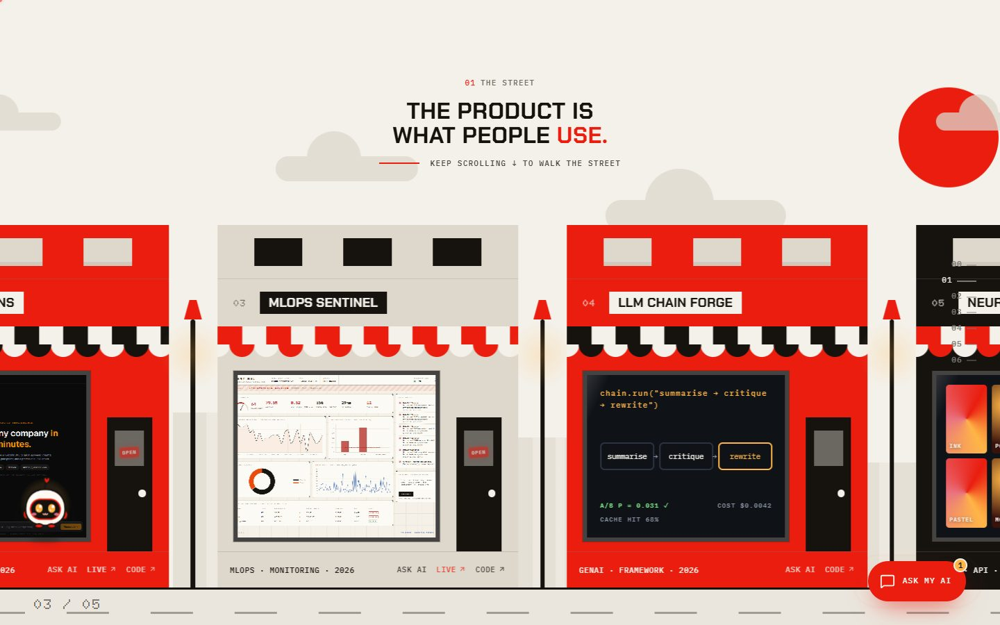<br /><sub><b>The street</b>: each project is a shop with a live demo in the window</sub></td>
    <td width="50%">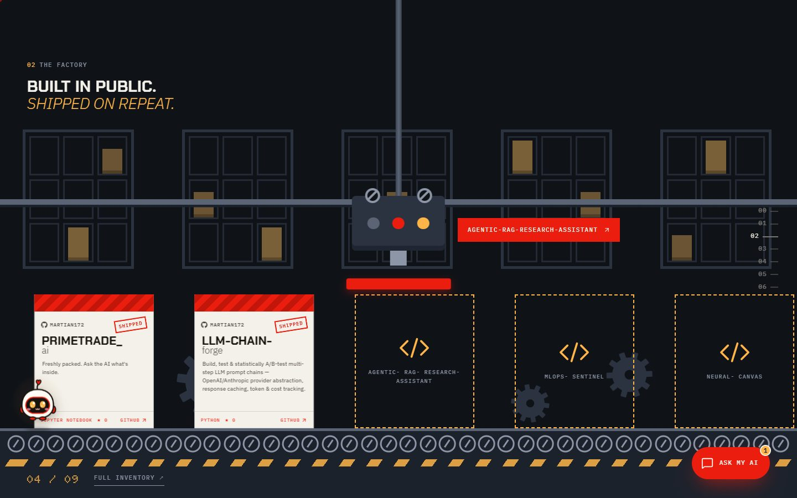<br /><sub><b>The factory</b>: live GitHub repos stamped on a conveyor</sub></td>
  </tr>
  <tr>
    <td>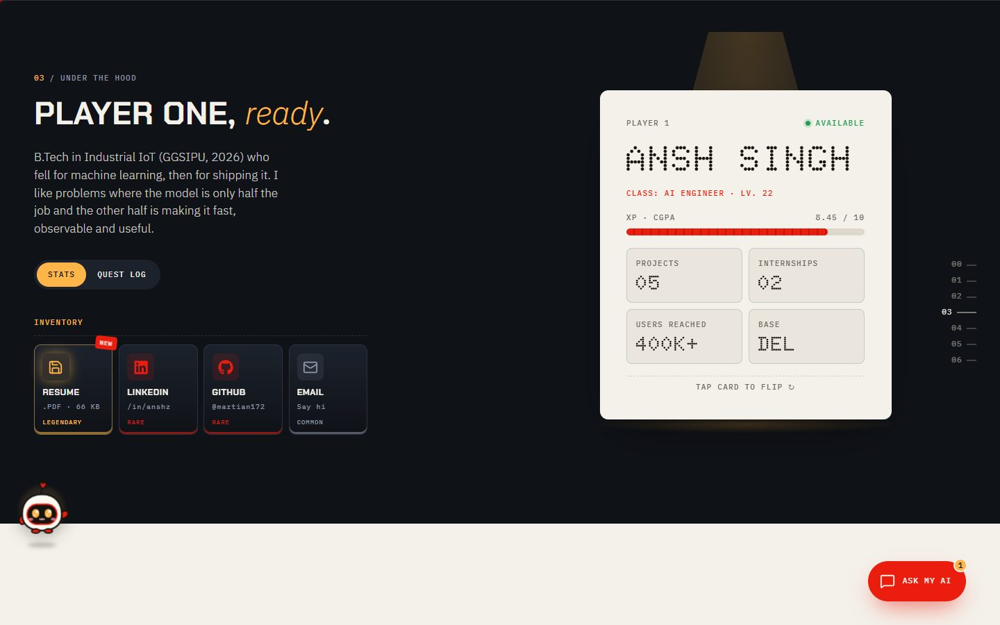<br /><sub><b>Under the hood</b>: Player One card and inventory</sub></td>
    <td>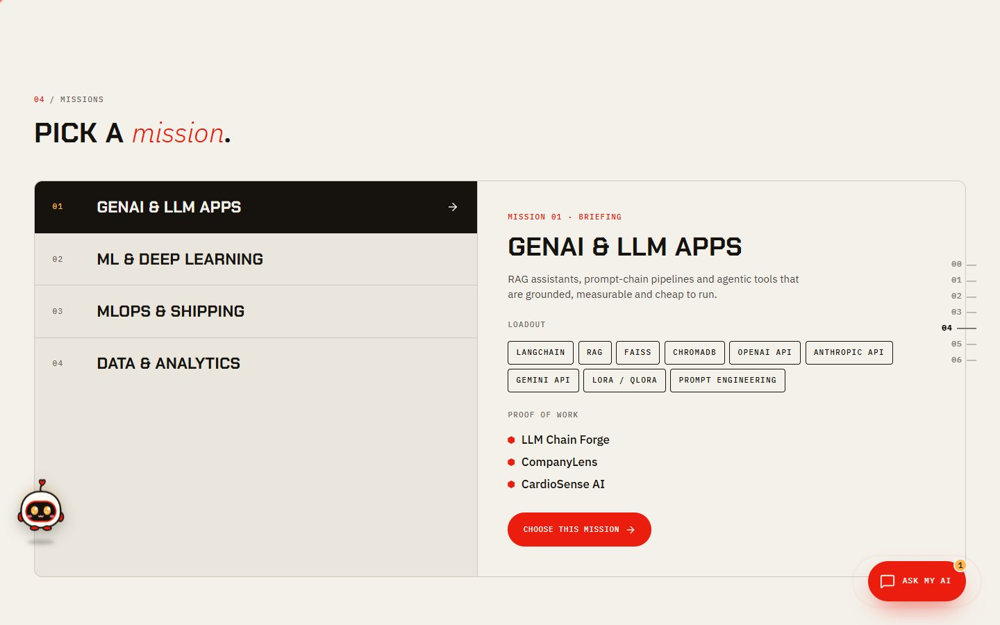<br /><sub><b>Missions</b>: skill areas, loadouts and proof of work</sub></td>
  </tr>
  <tr>
    <td>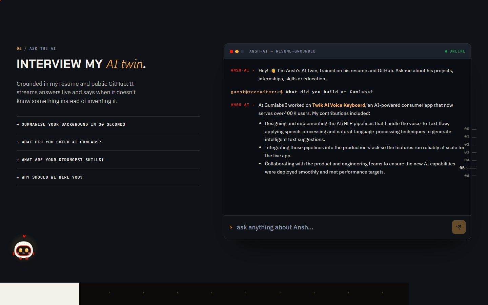<br /><sub><b>AI twin</b>: a real streamed answer, grounded in the resume</sub></td>
    <td>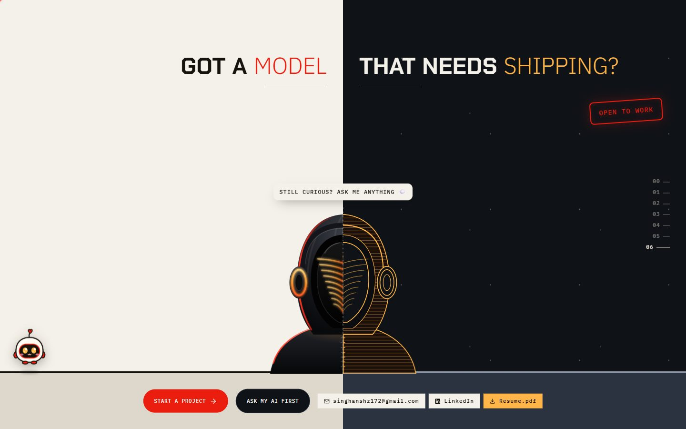<br /><sub><b>Finale</b>: "Open to work" neon, resume and LinkedIn</sub></td>
  </tr>
  <tr>
    <td>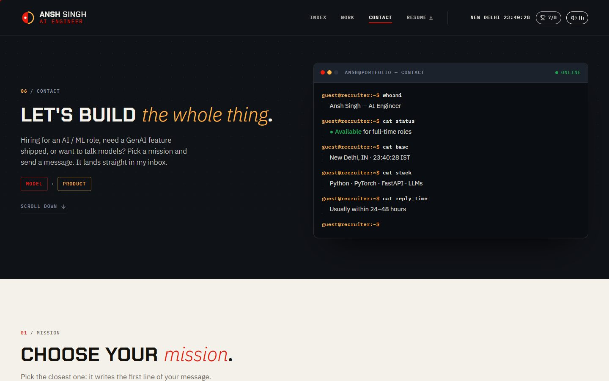<br /><sub><b>Contact</b>: terminal intro</sub></td>
    <td>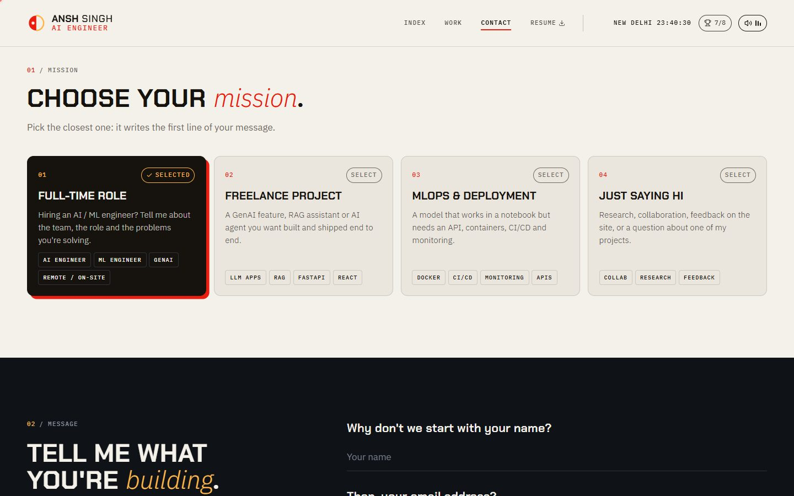<br /><sub><b>Contact</b>: choose a mission, it writes the first line</sub></td>
  </tr>
</table>

<p align="center">
  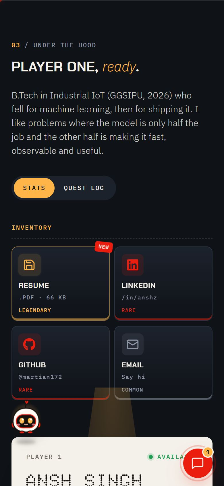
  &nbsp;&nbsp;
  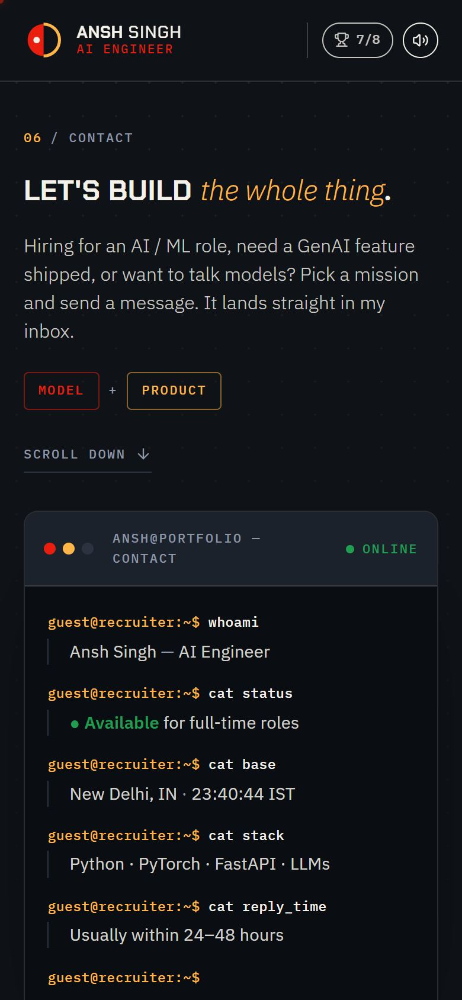
  <br /><sub>On a phone (390 px)</sub>
</p>

---

## How it works

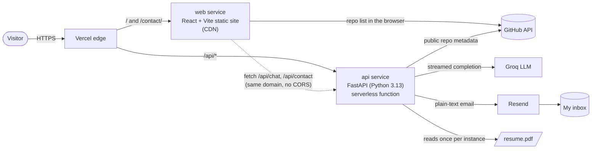

**AI chat (`POST /api/chat`)**
1. On the first request, the backend reads the resume PDF and fetches public GitHub repo metadata, then caches both for that instance.
2. Each question plus a short history window is sent to Groq with a strict system prompt: answer only from the resume and repo data, speak in first person, never invent metrics or details, and treat user text as untrusted.
3. Groq streams tokens back; FastAPI forwards them as plain text; React reads `response.body` and renders each chunk as Markdown as it arrives.

**Contact form (`POST /api/contact`)**
1. The page validates the fields, then posts name, email, message and mission.
2. The backend validates again, checks a hidden honeypot field and per-visitor rate limits, then sends a plain-text email through Resend with *Reply-To* set to the visitor.

---

## Tech stack

| Layer | Technology |
|---|---|
| **Frontend** | React 19, Vite 8, plain CSS (custom design system), `react-markdown`, `lucide-react`, `react-icons` |
| **Typography** | Chakra Petch (display), IBM Plex Sans (text), IBM Plex Mono (labels / terminal), Doto (dot-matrix readouts) |
| **Backend** | FastAPI, Pydantic v2, `httpx`, `pypdf`, Groq Python SDK, managed with `uv` |
| **AI** | Groq · `openai/gpt-oss-120b` (configurable), streaming completions |
| **Email** | Resend HTTP API |
| **Hosting** | Vercel (Services): static site on the CDN + Python serverless functions |

---

## Project structure

```text
.
├── vercel.json              # Two services on one domain: web (/) and api (/api/*)
├── backend/                 # FastAPI app (deployed as the "api" service)
│   ├── main.py              # Chat, contact, health; validation, rate limits, security headers
│   ├── resume.pdf           # Resume the AI reads
│   ├── pyproject.toml       # Python dependencies
│   └── uv.lock
├── frontend-ui/             # React + Vite site (deployed as the "web" service)
│   ├── index.html           # Portfolio page
│   ├── contact/index.html   # Contact page
│   ├── vite.config.js       # Multi-page build, CSP injection, /api dev proxy
│   ├── public/              # Resume PDF, favicon, project screenshots
│   └── src/
│       ├── App.jsx          # Portfolio page: chapters, chat, inventory
│       ├── ContactPage.jsx  # Contact page
│       ├── SplitStory.jsx   # Scroll-scrubbed hero and finale
│       ├── Street.jsx       # Projects as shop fronts
│       ├── Factory.jsx      # GitHub repos on a conveyor
│       ├── ChatWidget.jsx   # Floating AI chat drawer
│       ├── Buddy.jsx        # Bit, the draggable pet
│       ├── Achievements.jsx # Achievements, trophy room, Konami / CRT mode
│       ├── shared.jsx       # Shared config, cursor, clock, sound toggle, footer
│       ├── sound.js         # Web Audio sound kit
│       └── *.css            # Design system and page styles
├── docs/screenshots/        # Images used in this README
├── .env.example             # Template for local secrets (copy to .env)
└── pyproject.toml           # Root Python env for running the backend locally
```

---

## Run it locally

**Requirements:** Python 3.13 with [uv](https://docs.astral.sh/uv/), Node.js 20+, a free [Groq API key](https://console.groq.com/keys) and, for the contact form, a free [Resend API key](https://resend.com/api-keys).

```bash
# 1. Clone
git clone https://github.com/Martian172/ai_portfolio.git
cd ai_portfolio

# 2. Secrets: copy the template and fill in your keys (never commit .env)
cp .env.example .env

# 3. Backend (http://127.0.0.1:8000)
uv sync
uv run uvicorn backend.main:app --reload --host 127.0.0.1 --port 8000

# 4. Frontend, in a second terminal (http://127.0.0.1:5173)
cd frontend-ui
npm install
npm run dev
```

Open http://127.0.0.1:5173. The Vite dev server forwards `/api` to the backend on port 8000, so it behaves exactly like production. The contact page is at http://127.0.0.1:5173/contact/.

> `--reload` restarts the backend when Python files change. Changes to `.env` need a manual restart.

---

## Environment variables

All secrets live **only on the backend**: in `.env` locally and in Vercel's *Environment Variables* in production. Nothing secret is ever bundled into the frontend.

| Variable | Required | Purpose |
|---|---|---|
| `GROQ_API_KEY` | ✅ | Powers the AI chat |
| `GROQ_MODEL` | | Model name (default `openai/gpt-oss-120b`) |
| `RESEND_API_KEY` | for contact | Sends contact-form messages |
| `CONTACT_TO_EMAIL` | for contact | Inbox that receives messages (with Resend's test sender, the address you signed up with) |
| `CONTACT_FROM_EMAIL` | | Sender after verifying your own domain in Resend |
| `GITHUB_USERNAME` | | Whose public repos the AI knows about (default `martian172`) |
| `GITHUB_TOKEN` | | Optional read-only token to avoid GitHub's anonymous rate limit |
| `ALLOWED_ORIGINS` | | Extra origins allowed to call the API from a browser (not needed on one domain) |
| `CHAT_LIMIT_PER_MINUTE` / `CHAT_LIMIT_PER_DAY` / `CHAT_GLOBAL_LIMIT_PER_DAY` | | Chat abuse limits (defaults 6 / 60 / 1500) |
| `CONTACT_LIMIT_PER_HOUR` / `CONTACT_LIMIT_PER_DAY` / `CONTACT_GLOBAL_LIMIT_PER_DAY` | | Contact limits (defaults 3 / 6 / 100) |
| `ENABLE_DOCS` | | `true` shows `/docs` locally; keep off in production |

See [`.env.example`](.env.example) for a commented template.

---

## Deploying to Vercel

1. Import the repo at [vercel.com/new](https://vercel.com/new), keep **Root Directory** at the repo root, and choose the **Services** preset. `vercel.json` defines both services.
2. Add `GROQ_API_KEY`, `RESEND_API_KEY` and `CONTACT_TO_EMAIL` (plus optional `GITHUB_TOKEN`) under **Settings → Environment Variables**.
3. Deploy. Every push to `main` redeploys automatically.

On Vercel the backend loads the resume and repo list on its first request (serverless-friendly), trusts Vercel's forwarded IP header for rate limiting, and streams chat responses.

---

## Security

| Protection | Where |
|---|---|
| API keys only in server-side environment variables; `.env` is git-ignored | backend |
| Per-visitor and global rate limits on chat and contact | backend |
| Strict input validation (lengths, email format, no line breaks or HTML in names, unknown fields rejected), 64 KB body cap | backend |
| Honeypot field silently drops contact-form bots; emails are plain text with *Reply-To* set to the visitor | backend |
| Prompt-injection guard in the system prompt; phone number never returned by the API | backend |
| `/docs` and `/openapi.json` hidden; minimal `/api/health` | backend |
| Content Security Policy (own scripts only; connects only to GitHub's API and the same-origin API) | frontend build |
| `X-Frame-Options: DENY`, `nosniff`, `Referrer-Policy`, `Permissions-Policy`, HSTS | Vercel headers + backend |
| AI replies rendered with `react-markdown`: no raw HTML, unsafe links stripped | frontend |

The rate limiter is in memory, so each serverless instance counts separately; a spending limit in the Groq console provides the hard ceiling.

---

## Author

<table>
  <tr>
    <td>

**Ansh Singh** · AI Engineer · New Delhi, India

B.Tech in Industrial IoT (GGSIPU, 2026). AI Engineer intern at **Gumlabs** (Twik AI Voice Keyboard, 400K+ users) and Data Analyst intern at **IBM**. I build ML models and the products around them: APIs, deployment and monitoring.

[🌐 Portfolio](https://anshsingh-ai.vercel.app) · [💼 LinkedIn](https://www.linkedin.com/in/anshz) · [🐙 GitHub](https://github.com/Martian172) · [✉️ singhanshz172@gmail.com](mailto:singhanshz172@gmail.com)

**Open to full-time AI / ML roles.** The fastest way to reach me is the [contact page](https://anshsingh-ai.vercel.app/contact/).

  </td>
  </tr>
</table>

<div align="center">
<sub>Built with FastAPI, Groq and React · Designed and developed by Ansh Singh</sub>
</div>
